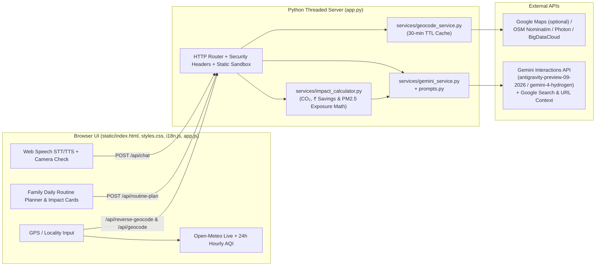

# 🌬️ VayuMitra AI — Urban Air Quality & Family Routine Companion (PromptWars Challenge 06)

**VayuMitra (वायुमित्र)** is an accessible, voice-first, multilingual (**Hinglish, हिंदी Hindi, मराठी Marathi, Simple English**) Urban Air Quality Assistant built for **PromptWars Challenge 06**—designed so everyday families, including non-readers, elders, and outdoor workers, can use it effortlessly in real time without typing or reading scientific jargon.

1. **Tailored Low-Emission Steps** (commute swaps, fuel efficiency, zero waste-burning habits)
2. **Zero-/Low-Cost Indoor Air Hacks** (timed ventilation matched to today's cleanest 2-hour window, wet mopping, kitchen exhaust, indoor plants)
3. **Clear Quantified Impact Insights** (weekly kg CO₂ saved, daily PM2.5 / cigarette-equivalent exposure drop, monthly ₹ fuel savings, annual tree equivalents)
4. **Inclusive Voice & Camera Guidance** (hands-free voice chat, synchronized word-by-word TTS, photo check of sky smog or rooms, and 1-tap WhatsApp family alerts)

> **Live Deployment:** _Add your deployed HTTPS URL here (e.g., `https://vayumitra-air-quality.onrender.com` or Cloud Run URL)_
> **Security Note:** API keys are **never exposed to or entered in the browser**. All secrets stay strictly server-side in `.env` (local) or cloud environment secrets (production), and REST calls authenticate via the `x-goog-api-key` header with sanitized error handling.

---

## 🏗️ Architecture



### Project Structure

```text
urban_air_quality_assistant/
├── app.py                        # HTTP server entrypoint, routing, security headers, static sandboxing
├── prompts.py                    # VayuMitra system persona, chat & routine prompt builders, response cleaners
├── services/
│   ├── geocode_service.py        # Reverse/forward geocoding with multi-provider fallback & thread-safe TTL cache
│   ├── impact_calculator.py      # Deterministic CO₂, monthly fuel savings & PM2.5 exposure reduction engine
│   └── gemini_service.py         # Input validation, Gemini SDK + header-auth REST fallback, key-safe error redaction
├── static/
│   ├── index.html                # Semantic, accessible HTML5 layout (landmarks, fieldset/legend, ARIA live region)
│   ├── styles.css                # Responsive dark UI, 24h AQI bar, routine KPI cards, reduced-motion support
│   ├── i18n.js                   # Complete Hinglish, Devanagari Hindi, and Simple English UI localization
│   └── app.js                    # GPS/sensor logic, 24h chart, Routine Planner, synced TTS/STT, camera compression
├── tests/
│   └── test_app.py               # Unit + live HTTP integration tests (sanitization, impact math, security, APIs)
├── Dockerfile                    # Production container (python:3.11-slim)
├── render.yaml                   # One-click Render Blueprint deployment
├── requirements.txt              # google-genai, python-dotenv
└── .env.example                  # Safe environment variable template
```

---

## 🧠 Prompt Design

All prompting logic lives in [`prompts.py`](prompts.py) and [`services/gemini_service.py`](services/gemini_service.py):

1. **Zero-Jargon Everyday Persona (`BASE_SYSTEM_PROMPT`):**
   - Designed so non-technical users (elders, homemakers, outdoor workers, students) understand pollution instantly.
   - Translates raw `PM2.5` readings into relatable cigarette-equivalent smoke exposure (`round(pm25 / 22)` cigarettes/day) and concrete daily actions across the 4 pillars (safe timing & masks, indoor air care, clean transport/no waste burning, and family health impact).
2. **Live Context Grounding (`build_system_instruction`):**
   - Injects live detected locality + GPS coordinates, live US AQI + PM2.5 from Open-Meteo, selected Family Profile (Whole Family, Elderly/Asthma, Young Children, Outdoor Worker, Pregnant Mother), language, and verbosity mode (`voice_concise` 2–3 spoken sentences vs. `detailed_plan`).
   - Attaches `google_search` and `url_context` tools for real-time local context, while enforcing a strict **zero-URL / zero-citation** rule plus regex post-processing (`strip_resources_and_clean`) so responses sound like a real human companion.
3. **Dual-Script Voice Sync (`|||DEVANAGARI_VOICE|||`):**
   - When the user selects **Hinglish**, Gemini outputs readable Romanized Hinglish for the chat bubble followed by a `|||DEVANAGARI_VOICE|||` delimiter and the exact Devanagari Hindi script for the Indian Hindi TTS engine (`hi-IN`), preventing awkward English-accent pronunciation of Hindi words.
4. **Hybrid Deterministic + AI Structured Routine Planning (`build_routine_system_instruction` + `impact_calculator.py`):**
   - First computes mathematically grounded metrics (`weekly_co2_saved_kg`, `monthly_fuel_savings_inr`, `exposure_reduction_pct`, `annual_trees_equivalent`) from the family's commute mode/distance, cooking fuel, exhaust availability, outdoor hours, and live AQI.
   - Passes those exact metrics to Gemini with a strict JSON schema (`low_emission_steps`, `indoor_air_hacks`, `impact_insights`, `spoken_summary`) to personalize every recommendation—falling back gracefully to the deterministic multilingual engine when offline or unconfigured.

---

## 🎯 Core User Journey

1. **Auto-Detect Local Air Quality:** On load, the app detects your GPS location (or accepts a typed locality/pincode), displays the Traffic-Light AQI Meter, calculates today's cleanest 2-hour ventilation window, and renders a **24-hour hourly AQI bar**.
2. **Build a Family Daily Routine Plan:** Choose a 1-click preset (*Office + School Family*, *Seniors + At Home*, or *Outdoor Worker*) or enter your commute, distance, cooking fuel, peak outdoor hours, and household members → click **Build My Family Plan** to view KPI impact cards and the 3 tailored action lists, listen aloud, or share on WhatsApp.
3. **Ask by Voice, Text, or Camera:** Switch between Hinglish, Hindi, and Simple English, pick a family profile, tap the mic (or enable Hands-Free Call), or upload a sky/room photo for immediate multimodal air-safety guidance.

---

## 🔑 Environment Setup & Local Run

1. **Create and activate a virtual environment, then install dependencies:**
   ```powershell
   python -m venv .venv
   .\.venv\Scripts\python.exe -m pip install -r requirements.txt
   ```
2. **Configure server-side API keys (never commit `.env`):**
   ```powershell
   Copy-Item .env.example .env
   ```
   Edit `.env`:
   ```env
   GEMINI_API_KEY=your_gemini_api_key_here
   # Optional: Google Maps Geocoding ahead of free OpenStreetMap Nominatim/Photon
   # GOOGLE_MAPS_API_KEY=your_google_maps_api_key_here
   # Optional model overrides
   # GEMINI_MODEL=gemini-4-hydrogen
   # GEMINI_AGENT=antigravity-preview-09-2026
   ```
3. **Start the server:**
   - Double-click `run_app.bat`, **or** run:
     ```powershell
     .\.venv\Scripts\python.exe app.py
     ```
4. **Open in Chrome or Edge:** Visit `http://localhost:8000`.

---

## 🧪 Running Automated Tests

```powershell
.\.venv\Scripts\python.exe -m unittest discover -s tests -v
```

Covers prompt sanitization, dual-script splitting, CO₂/PM2.5 impact calculations, API key redaction, input validation, path-traversal protection, security headers, and live HTTP endpoint responses.

---

## ☁️ Production Deployment (HTTPS Required for GPS & Mic)

### Option 1: Render (One-Click Blueprint via `render.yaml`)
1. Push this repository to GitHub (confirm `.env` is ignored).
2. In [Render](https://render.com), choose **New → Blueprint** and connect your repository.
3. Set `GEMINI_API_KEY` (and optional `GOOGLE_MAPS_API_KEY`) as encrypted environment variables.
4. Deploy to receive a live `https://*.onrender.com` URL.

### Option 2: Google Cloud Run
```bash
gcloud run deploy vayumitra-air-quality \
  --source . \
  --region asia-south1 \
  --allow-unauthenticated \
  --set-env-vars GEMINI_API_KEY="your_gemini_api_key_here"
```

### Option 3: Docker
```bash
docker build -t vayumitra .
docker run -d -p 8000:8000 --env-file .env --name vayumitra vayumitra
```

---

## 📡 API Endpoints

| Endpoint | Method | Purpose |
| :--- | :--- | :--- |
| `/` | `GET` | Serves the VayuMitra web application |
| `/api/health` | `GET` | Server readiness + key/SDK availability status |
| `/api/reverse-geocode?lat=&lon=` | `GET` | Cached locality & city lookup from GPS coordinates |
| `/api/geocode?q=` | `GET` | Forward lookup for typed area, city, or pincode |
| `/api/routine-plan` | `POST` | Generates tailored low-emission steps, indoor air hacks & quantified impact insights |
| `/api/chat` | `POST` | Conversational voice/text/vision advice grounded in live AQI and profile |
